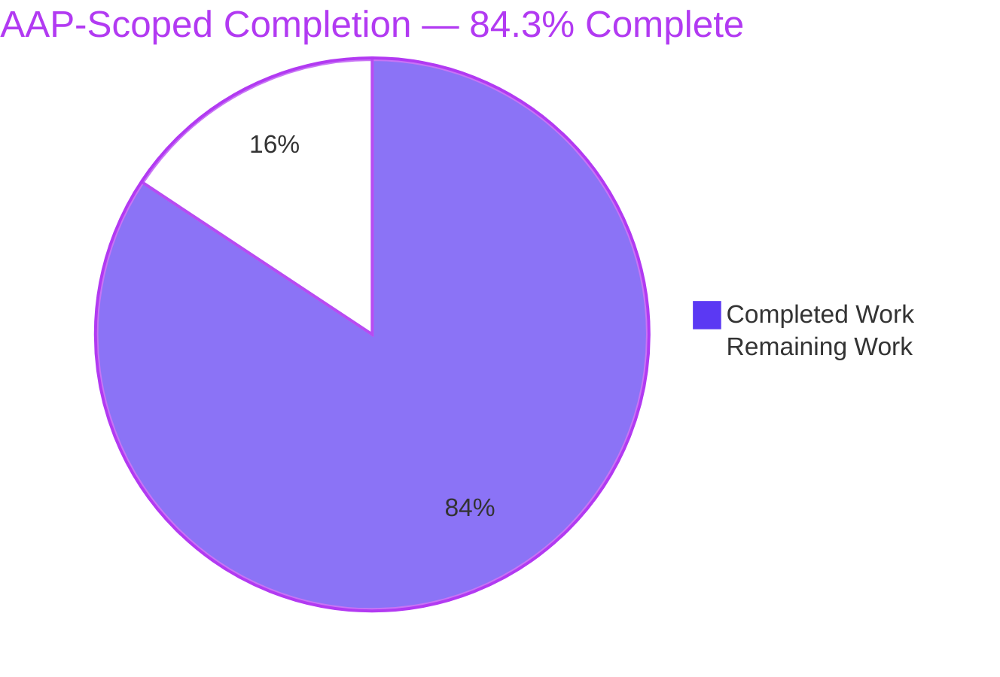
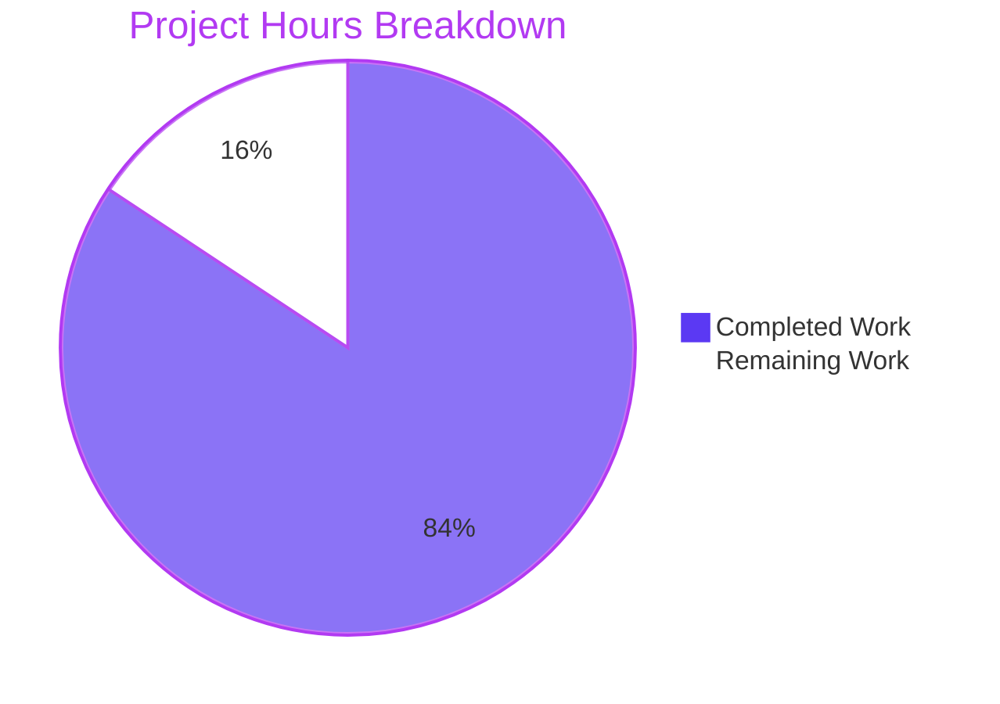
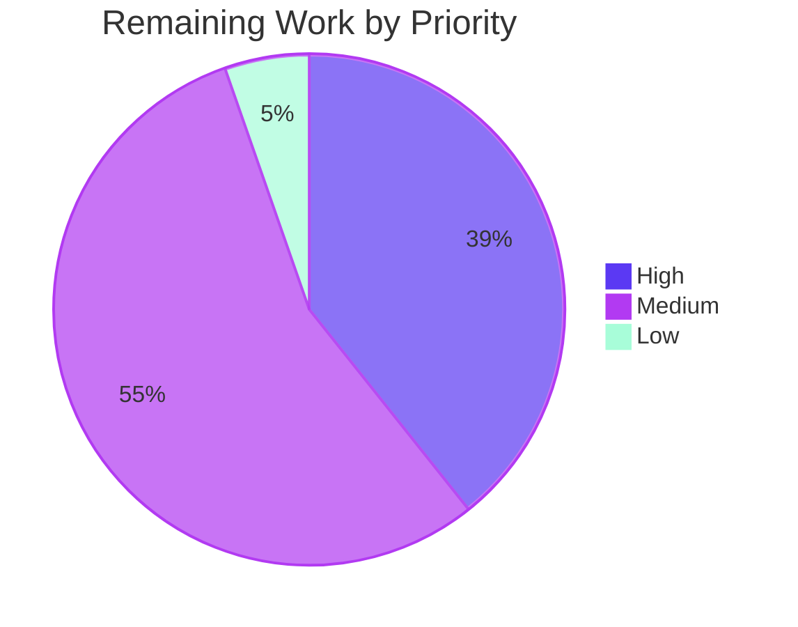
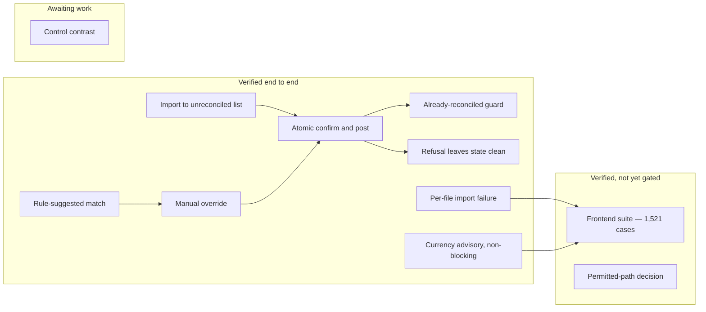

# 1. Executive Summary

## 1.1 Project Overview

The ERPNext Bank Reconciliation single-page application at `erpnext/banking/` lets an accountant import a bank statement, review the rule engine's suggested match, accept it or link a different Payment Entry, Journal Entry or Invoice, and post the reconciliation. This work completed and hardened that workflow: the five prescribed failure modes behave as specified, the workspace type-checks and builds cleanly on Node.js 24, a frontend suite enforces a coverage floor, and a reviewer's walkthrough traces every changed path to its requirement. Financial writes are server-authoritative and refusals are legible.

## 1.2 Completion Status



Completed `#5B39F3` · Remaining `#FFFFFF`.

| Metric | Value |
| --- | --- |
| Total Hours | **357 h** |
| Completed Hours (AI + Manual) | **301 h** (301 h autonomous, 0 h manual) |
| Remaining Hours | **56 h** |
| Percent Complete | **84.3 %** (301 ÷ 357) |

## 1.3 Key Accomplishments

- ✅ Reconciliation verified end to end: import, suggested match, override, atomic post, undo.
- ✅ A refused post shows the server's words in a dismissible dialog and changes nothing.
- ✅ An already-reconciled transaction cannot be re-posted; the server answers HTTP 417.
- ✅ A refused import marks the failed file and creates no transactions.
- ✅ A currency mismatch warns without blocking; the server refuses the post.
- ✅ 1,521 frontend cases pass at 85.04 % line coverage against an enforced 80 % floor.
- ✅ 134 backend tests pass on each engine; zero type errors, clean build on Node 24.
- ✅ A PR walkthrough maps all 159 changed application paths to their requirements.

## 1.4 Critical Unresolved Issues

**12 items are open: 2 of the 17 acceptance items the plan set (SC1 and SC4), plus 10 further defects, decisions and unexercised paths.** The other 15 acceptance items — five failure modes, six test scenarios and SC2, SC3, SC5, SC6 — are met, and all three of the reviewer's later instructions are delivered.

| Issue | Impact | Owner | ETA |
| --- | --- | --- | --- |
| **SC4** — Two paths in the bank-account controller directory sit outside the change set's agreed scope | The permitted-path criterion cannot be signed off as written; the code itself is correct and green on both engines | Engineering lead / plan owner | 1 day |
| **SC1** — No pipeline runs the frontend acceptance gate | 1,521 cases and the 80 % line floor are enforced only on a developer's machine, so a regression can reach the default branch | CI owner | 1 day |
| Undo removes one allocation row per call on a transaction matched to two or more vouchers (`bank_transaction.py` L417–421) | A second Undo is needed to finish reversing; the interim state is internally consistent | Backend | 1 day |
| Concurrent-post refusal is built but not exercised under a genuine two-session race | The row-locked read answers "Refresh Required" (`bank_reconciliation_tool.py` L1405–1424), proven only by an injected-staleness test; a conflict raised elsewhere in the save could still reach the reviewer as a raw status code | Backend | 1 day |
| PDF table re-extraction bypasses the titled-refusal wrapper (`bank_statement_import_log.py` L1403–1405) | A parser failure while adjusting a table region surfaces as an unhandled server error instead of a readable refusal | Backend | 0.5 day |
| Six solid-control colour pairs measure below 4.5:1 contrast | Buttons and badges in the design system's brand colours fall short of AA in both themes | Design-system owner | 2 days |
| Desktop-only breakpoint moved from 768 px to 640 px or a fine pointer (`pages/BankReconciliation.tsx` L136, L215) | Contrary to the plan's "preserved unchanged"; viewports of 640–767 px now receive the full workbench | Product / design owner | 0.5 day |
| Skip link — 2 defects: focus falls to the page body while the unsupported-screen notice shows, and the focused link renders unpadded over the breadcrumb (`components/common/PageShell.tsx` L25) | Keyboard users at narrow widths lose their place; the focused chip is visually broken at every width | Frontend | 0.5 day |
| The per-file import failure marker lives in tab-scoped session storage | A refused file that parsed rows reads "Not Started" again in a new tab or for another reviewer; zero-row files stay red because that state comes from the server | Product | 1 day |
| The three voucher-creation modals' save paths have never been driven against a live site | Line coverage is 44.4 % (Bank Entry), 55.4 % (Transfer) and 65.3 % (Record Payment), so creating a voucher from a transaction is the least-proven journey | Frontend / QA | 1 day |
| The workspace runbook carries stale counts and claims (`erpnext/banking/README.md` L905, L920, L1000, L1088) | It cites four controllers and superseded per-module test counts, lists modified files as unchanged, says no decorator changed and quotes the old breakpoint | Engineering lead | 0.5 day |

## 1.5 Access Issues

No access issues identified. The repository and both submodules, both database engines, a local bench serving `/banking`, and the package registry were all reachable and usable.

## 1.6 Recommended Next Steps

1. **[High]** Rule on the bank-account controller's two paths — amend the scope or re-plan; reverting the fix inside them reopens a financial-write bypass.
2. **[High]** Add the acceptance gate, with one shuffled seed, to an existing workflow on Node ≥ 24.15.
3. **[High]** Make one Undo release every allocation row, and prove the concurrent-post refusal under a genuine race.
4. **[Medium]** Settle brand-colour contrast and the desktop-only breakpoint with the design-system owner, then re-verify both themes.

# 2. Project Hours Breakdown

## 2.1 Completed Work Detail

| Component | Hours | Description |
| --- | --- | --- |
| Frontend test infrastructure and fixtures | 22 | A runner configuration deliberately independent of the build config, so tests need no provisioned bench; a simulated-DOM harness stubbing the boot user, roles, every permission array, the currency and company lookups, `matchMedia`, `ResizeObserver`, pointer capture and virtualiser measurement; a 1,513-line typed factory module shaped by the real server payloads; and a shared panel renderer (`banking/vitest.config.ts`, `banking/src/test/`) |
| Frontend test suite — 62 suites, 1,521 cases | 95 | Suites covering the workbench, the importer, all four routes, the API-client hooks, the shared libraries, the design-system primitives and the design tokens, including the six mandated scenarios and all five failure modes |
| Backend test suites — 5 bank DocType modules | 26 | 134 tests per engine across `bank_transaction`, `bank_reconciliation_tool`, `bank_transaction_rule`, `bank_statement_import_log` and `bank_account`, including rule stamping, first-match-wins by priority, the already-reconciled refusal and the currency guards |
| Dismissible failure reporting on confirm/post | 16 | `BankRecErrorDialog.tsx` composed from the existing alert dialog and error banner, the rejection path in `BankReconciliation/utils.ts`, two feature atoms, focus capture and restoration (`hooks/use-return-focus.ts`) and viewport-clamped scrolling |
| Statement import failure surfacing | 16 | Backend error captured instead of discarded in `BankStatementImporter/CSV/StatementDetails.tsx`, a three-state per-file indicator in `pages/BankStatementImporter.tsx`, a zero-transaction guard, and placeholder-attachment cleanup on both endings |
| Already-reconciled guard and stale-client convergence | 10 | Confirm disabled on the server's own predicate with an explanatory tooltip, plus cache eviction, revalidation and a fail-closed selection clear after a refusal |
| Currency advisory and no-deduplication behaviour | 6 | Amber advisory badge with tooltip on mismatched rows in `MatchAndReconcile.tsx`, proven not to disable confirm; duplicate re-imports verified to render exactly as the server returns them |
| Backend authorisation and input-validation hardening | 40 | Across the five bank controllers: per-account permission on the closing-balance write, an argument-arity guard applied at 28 call sites, POST-only on four state-changing endpoints, currency enforcement on the posting path, a row-locked stale-state refusal on posting, total date parsing, voucher-type and clearance-write validators, company-scoped rule evaluation, deterministic candidate ordering, and a markdown allowlist over server-supplied text |
| Frontend robustness, responsive layout and accessibility | 34 | Error boundary, render-failure surface and page shell (`components/common/`), available-height and scroll-overflow hooks, strict amount parsing, scope-stamped selection, progress-figure gating, routing history correction, and design-token-only styling across the workbench and importer |
| Type and build integrity | 2 | The implicit-`any` parameter in `banking/proxyOptions.ts` annotated and a `typecheck` script added, so zero-error compilation is observable rather than assumed |
| Dependency and install integrity | 4 | Seven exactly pinned test packages, four resolution overrides including the one without which the install fails outright, and a clean frozen-lockfile install |
| Workspace runbook and PR walkthrough | 12 | `banking/README.md` rewritten from the scaffold template into a 1,211-line operating manual, and `blitzy/documentation/PR Walkthrough.md` — an 844-line reviewer's tour with a review order, area-by-area rationale, 17-row requirement traceability and a 162-row changed-path inventory whose commands reproduce as written |
| Success-criteria verification | 18 | Dual-engine backend runs, the coverage gate proved to bite, build, lint and type gates, end-to-end runtime verification of the workflow and all five failure modes, and submodule and schema integrity checks |
| **Total** | **301** | |

## 2.2 Remaining Work Detail

| Category | Hours | Priority |
| --- | --- | --- |
| **H1** — Rule on the bank-account controller's two paths and review the backend diff as a security and behaviour change set, including the server-side refusal of currency-mismatched posts; once amended, extend the argument and permission guard to that directory's four remaining unguarded endpoints with tests on both engines, and route PDF table re-extraction through the titled-refusal wrapper | 8 | High |
| **H2** — Wire the frontend acceptance gate into an existing pipeline on Node ≥ 24.15, publishing the lcov artefact | 6 | High |
| **H3** — Reversal-path robustness: remove every allocation row in one Undo call, and prove the concurrent-post refusal under a genuine two-session race on both engines | 8 | High |
| **M1** — Accessibility decisions: brand-colour contrast with per-mode token overrides for the six failing solid-control pairs; a ruling on the desktop-only breakpoint; the skip link offered only when its target renders, with padding when focused | 10 | Medium |
| **M2** — Coverage for the three voucher-creation modals, each save path driven against a seeded site, plus the app-shell guest branch and a branch-coverage floor | 8 | Medium |
| **M3** — Per-file failure indicator polish (carry the stored server message, make it keyboard reachable), the statement summary tile correction, and the stale prune comment in `pages/BankStatementImporter.tsx` | 5 | Medium |
| **M4** — Release mechanics: workspace version, release notes, staging deploy rehearsal and smoke test on both engines; correct the runbook's stale content; reconcile the plan text for the persisted failure map and the selection atom; confirm no external client calls the four POST-only endpoints by GET | 8 | Medium |
| **L1** — Operational alignment: scheduler and automatic rule evaluation agreement, realtime socket port for the target deployment | 3 | Low |
| **Total** | **56** | |

## 2.3 Hours Reconciliation

The completion figure is derived only from work the agreed plan scoped, plus the standard path-to-production activities needed to deploy it:

```
Completed hours  = 301   (Section 2.1 total)
Remaining hours  =  56   (Section 2.2 total)
Total hours      = 357   (301 + 56)
Completion       = 301 ÷ 357 = 84.3 %
```

Priority distribution of the 56 remaining hours: **High 22 h**, **Medium 31 h**, **Low 3 h**.

Four bodies of work were deliberately excluded from these hours because they lie outside the agreed scope and are not required to deploy what was built: bounded pagination and a covering index on the two workbench list endpoints; virtualising the large statement-preview tables; converting the desktop-only breakpoint into a render-level guard; and a product decision on duplicate re-imports together with a review of the bank DocType permission personas. Each is carried instead as a risk in Section 6 and as a recommendation in Section 8, so it is visible without inflating the estimate. Two further bodies of work are excluded from these hours at the reviewer's direction, because neither is required for this project to be successful: production deployment hardening — security headers and CSP, `Secure`/`HttpOnly` cookies, HTTPS with HSTS, traceback exposure disabled, production WSGI behind a reverse proxy, compression and immutable asset caching, and websocket upgrade headers — and a repeatable browser regression suite for the four routes and the confirm, refusal and import journeys. Their related risks remain visible in Section 6.

# 3. Test Results

Every figure below was produced by executing the suites in this repository on Node.js 24.22.2 and reading the result. The frontend gate is `yarn test:coverage` from `erpnext/banking`; the backend suites are `bench --site <site> run-tests --lightmode --module erpnext.accounts.doctype.<module>.test_<module>`, run module by module on each database engine.

| Area / Category | Framework | Tests | Passed | Failed | Coverage | What This Proves |
| --- | --- | --- | --- | --- | --- | --- |
| Reconciliation workbench, matching-rule form and action log | Vitest 4 (simulated DOM) | 602 | 602 | 0 | 79.54 % lines | A reviewer can list unreconciled transactions, read the rule-suggested match, override it, post atomically, be refused without state changing, and undo |
| Statement importer | Vitest 4 | 129 | 129 | 0 | 98.77 % lines | An import reports its own outcome per file, refuses a statement that would post nothing, and never creates a transaction client-side |
| Routes and pages | Vitest 4 | 142 | 142 | 0 | 92.40 % lines | All four routes and the catch-all mount, and the importer list renders its three per-file states correctly |
| Shared libraries and formatters | Vitest 4 | 246 | 246 | 0 | 96.94 % lines | Server errors are parsed and surfaced verbatim, money and dates format per company defaults, and amount and date inputs reject malformed values |
| Design-system primitives and design tokens | Vitest 4 | 213 | 213 | 0 | 82.21 % lines | Dialogs, tables, badges, markdown and list virtualisation behave as the workbench relies on, and every styled value resolves to a token |
| Shared hooks and application shell | Vitest 4 | 93 | 93 | 0 | 96.11 % lines | Panels measure and re-measure their available height, focus returns to the control that opened a dialog, and the shell renders only for a signed-in user |
| Settings, page shell and shared link field | Vitest 4 | 96 | 96 | 0 | 81.93 % lines | Preferences and the shared link field stay operable and keyboard-reachable, and a render failure degrades to a recoverable surface instead of blanking the page |
| Bank DocType controllers — both engines | Frappe unittest | 268 | 268 | 0 | not instrumented | Rule stamping and first-match-wins, the already-reconciled and currency refusals, import parsing and the authorisation guards behave identically on MariaDB and PostgreSQL (21, 46, 31, 26 and 10 tests per module, 134 per engine) |

Whole-workspace frontend line coverage measured **85.04 % (3,271 of 3,846 lines)** against the reporter-enforced 80 % floor — a margin of 194 lines. Statements 84.18 %, functions 78.50 %, branches 73.15 %; only lines are gated. The suite is order-independent: a shuffled run with a fixed seed passes all 62 files and 1,521 cases. Alongside the suites, the static gates all exit 0: `tsc -b` with zero errors, ESLint with zero violations, ruff check, import order and format on all 49 bank DocType files, the repository's test-correctness rules and Frappe's correctness rules with zero findings, and the cross-engine SQL check on all ten changed Python files.

**Not Covered**

- **The three voucher-creation modals** — Bank Entry (44.4 % lines), Transfer (55.4 %) and Record Payment (65.3 %). Creating a voucher from a transaction is exercised far less than matching an existing one. A human should drive each modal end to end against a seeded site before release.
- **The application shell's guest branch** (63.6 % lines) — the redirect taken when the boot payload reports no signed-in user is not asserted. Worth one manual check with an expired session.
- **A genuine concurrent post.** The stale-state refusal is tested by injecting a changed `modified` stamp, because a same-connection write cannot reproduce two sessions racing; two real sessions posting the same transaction have not been run against the current code.
- **Undo on a transaction matched to two or more vouchers**, and the failure path of PDF table re-extraction — neither has a test that would catch the open defects in Section 1.4.
- **Branch and function coverage are not gated** at 73.15 % and 78.50 %; defensive paths are measured but not enforced, so a new module can lower them without failing the gate.
- **Layout, scrolling, breakpoints and render cost cannot be asserted at all.** Every suite runs in a simulated DOM that performs no layout, so virtualised lists, real scroll behaviour, the desktop-only breakpoint and the skip link's focus target are checked only by class names or by hand, and large-statement render cost is outside its reach.
- **Narrow failure branches covered by unit tests but never reached at runtime**: the secondary "view could not be refreshed" path, which needs a re-read to fail after a refusal has already failed; the non-server-shaped rejection branch; the PDF-password write banner, which needs a protected-PDF fixture; and the refused-cleanup handler on the placeholder statement attachment.
- **No pipeline runs any of this.** The frontend gate exists and is green, but no workflow invokes it, so the numbers above are reproduced on demand rather than enforced on every change.

# 4. Runtime Validation & UI Verification

The application was driven in a real browser against a running Frappe/ERPNext site seeded with a company, four bank accounts, 137 bank transactions and ten statement import logs. Signed in as `Administrator`, the session recorded **zero console error-level messages, zero uncaught exceptions, zero unhandled rejections and zero network responses of HTTP 400 or above** across every route. The current tree was then re-driven on a freshly seeded site: both routes render, the database, the API and the screen agree on every seeded row, and the session again produced no console errors and no response of HTTP 400 or above. The posting endpoints were also exercised directly over HTTP with a signed-in session.

- ✅ **Start-up, authentication and realtime** — Sign-in succeeds; signed-out visits to either route land on the login page; guest calls to the transaction endpoints are refused with 403; the realtime handshake and websocket upgrade succeed.
- ✅ **Bank account selection** — Account cards render; switching accounts re-queries the workbench and the counters, balances and progress follow the selection.
- ✅ **Unreconciled transaction list with rule-suggested match** — 83 results in the selected window, virtualised to 14 rendered rows, each carrying its reference badge, its violet rule badge titled with the matching rule, and a direction-coloured amount.
- ✅ **Balance and progress summary** — Opening, system closing, statement closing and difference all render with the shortfall stated in words; the progress bar reports 54 of 137 reconciled through an accessible value.
- ✅ **Match review and candidate pane** — Selecting a transaction opens the rule card, the recommended action and the ranked candidate vouchers, with the suggested voucher marked as a complete match and its confirm control enabled.
- ✅ **Confirm, post and undo** — One atomic server call posts the reconciliation (status Reconciled, nothing unallocated) and a manual override writes exactly one allocation row; an immediate second post is refused with HTTP 417 "already fully reconciled"; a GET is refused with 403 and a post without its CSRF token with 400; Undo returns the transaction to Unreconciled with no allocation rows.
- ✅ **Refusal reporting** — A refused post raises a dismissible alert dialog carrying the server's own message, traps and then restores focus to the control that opened it, and leaves the transaction unreconciled with no allocation rows and its original modification timestamp.
- ✅ **All five workbench tabs** — Match and Reconcile, Bank Reconciliation Statement, Bank Transactions (137 results with red, amber and green status badges), Bank Clearance Summary, and Incorrectly Cleared Entries as a designed empty state. No blank panel, no error panel, no stalled spinner.
- ✅ **Statement importer and per-file failure** — The upload control is genuinely disabled with no file staged; the previous-imports table shows six green completed rows and four solid-red failed rows, each reporting no dates, zero transactions and a zero balance; the failed detail route refuses with a disabled import control and an explicit "nothing has been created" notice.
- ⚠ **Routing, responsiveness and keyboard access** — An unknown route settles on the workbench with the history entry replaced, and no route overflows horizontally from 375 to 1920 pixels; but the unsupported-screen notice now appears only below 640 pixels rather than 768, and the skip link drops focus to the page body behind that notice and renders unpadded when focused.

**Never exercised at runtime.** The three voucher-creation modals were opened but no voucher was created, so their save paths have not been driven against a live site. No two sessions have posted the same transaction concurrently against the current code, no currency-mismatched transaction has been posted since the server began refusing them, and no multi-voucher Undo or failing PDF table re-extraction has been reproduced. The fine-pointer branch of the breakpoint was not observable in a headless browser. The large statement preview was observed but not measured under production data volumes. A protected-PDF import, an expired-session redirect and a re-read failure immediately following a refusal were not reproduced, because each needs a fixture or fault the environment cannot supply. All runtime verification was session-based rather than scripted, so none of it is repeatable by a pipeline today.

# 5. Compliance & Quality Review

## 5.1 Compliance Matrix

Each row states where the deliverable stands now, with the evidence a reader can open.

| # | Deliverable / Criterion | Status | Progress | Evidence |
| --- | --- | --- | --- | --- |
| 1 | Import a statement and see the resulting unreconciled transactions, each carrying the rule engine's suggestion stamped by priority | ✅ Pass | 100 % | Importer and workbench suites (129 + 602 cases); 31 rule-engine tests per engine cover stamping, first-match-wins and permission scoping; violet rule badge titled with the matching rule |
| 2 | Review the match: link a different Payment Entry, Journal Entry or Invoice, then confirm and post as one atomic server operation | ✅ Pass | 100 % | One `reconcile_vouchers` call with no optimistic client mutation (`BankReconciliation/utils.ts`); an override wrote exactly one allocation row typed "Matched" |
| 3 | An already-reconciled transaction cannot be posted again | ✅ Pass | 100 % | Client guard mirrors the server predicate in `MatchAndReconcile.tsx`; a second post over HTTP answers 417 "already fully reconciled", and `test_already_reconciled` plus the tool-level refusal test pass on both engines |
| 4 | A failed confirm leaves the transaction unreconciled with no partial posting | ✅ Pass | 100 % | Dismissible dialog with verbatim server text; server record unchanged including its modification timestamp |
| 5 | Import status view with a per-file failure indicator | ✅ Pass | 100 % | Three-state badge in `pages/BankStatementImporter.tsx` L794–807; four failed rows each with zero transactions created |
| 6 | Duplicate re-imports rendered as the backend produces them, with no client-side deduplication | ✅ Pass | 100 % | Verified no-op; duplicates render as distinct rows |
| 7 | Currency mismatch raises a non-blocking advisory, with enforcement left to the server | ✅ Pass | 100 % | Amber badge with explanatory tooltip and every confirm control enabled; the server refuses the mismatched post (`bank_transaction.py` L289–294, `test_reconcile_refuses_a_currency_mismatch`) |
| 8 | Zero TypeScript errors and zero build failures on Node ≥ 24 | ✅ Pass | 100 % | `tsc -b` exit 0 and `yarn build` exit 0 on Node 24.22.2, tree clean afterwards |
| 9 | Frontend line coverage ≥ 80 %, reporter-enforced | ✅ Pass | 100 % | 85.04 % lines (3,271 / 3,846) against `thresholds: { lines: 80 }` in `banking/vitest.config.ts`; a single-file run below the floor exits 1 |
| 10 | Mandated scenarios pass in continuous integration on both databases | ⚠ Partial | 70 % | Backend modules are discovered by the existing dual-engine workflows and pass 134 tests on each; the frontend suite passes locally but none of the 22 workflows invokes it |
| 11 | Change set confined to permitted paths, additions only, with the framework submodule and database schema untouched | ⚠ Partial | 90 % | 159 application paths, zero deletions, zero renames, no DocType JSON, field, index or migration; framework pointer `8a43de00d7f1e304598c910f0aa35aa384d474d7` with a clean tree; the two superproject documents are sanctioned by the reviewer — but two paths sit in the bank-account controller directory the plan classifies reference-only |
| 12 | Reviewer's PR walkthrough, linked from this guide | ✅ Pass | 100 % | `blitzy/documentation/PR Walkthrough.md`: eight sections, 17-row FM/TC/SC traceability, 162-row inventory matching `git diff --name-status` exactly, every documented command reproduced; linked from Appendix H |

## 5.2 AAP & Rule Divergences and Gaps

No user-specified rules were provided for this project, so every divergence below is measured against the agreed plan and, where marked Sanctioned, against the reviewer's later instructions, which outrank it. Task IDs refer to Section 2.2.

| # | What the AAP/Rule Required | What Was Delivered Instead | Why It Diverged | Impact | Remediation |
| --- | --- | --- | --- | --- | --- |
| 1 | 21 paths — one additive backend test module and zero backend source change | 159 application paths, including five bank controllers modified (+1,204 / −79) and 62 frontend suites | The endpoints the screen calls carried authorisation and input-validation gaps; closing them meant editing existing controller logic, which the additive-only allowance did not anticipate | Security materially stronger; the delivery is far larger than agreed and needs review as an intentional change set | Review the backend diff as a security change set (H1) |
| 2 | `bank_account/` is reference-only and "must not appear in the diff" | `bank_account.py` (+83 / −1) and `test_bank_account.py` (+278) are in the diff | The authorisation gap's root cause is in that file and nowhere else; relocating the endpoint would rename a published RPC path | The permitted-path criterion is not met as written; the code is correct and green on both engines | Grant an explicit scope amendment, or re-plan (H1) |
| 3 | The published RPC contract keeps its current shape | Four state-changing endpoints now accept POST only | Those endpoints answered GET, so a link, prefetch or crawler could trigger a financial state change | Any client that used GET is now refused with 403; this screen has always sent POST | Confirm no external integration relies on GET (M4) |
| 4 | Both new feature atoms are plain in-memory | The import-failure map persists to tab-scoped session storage | The per-file indicator must survive a reload to be useful | None functional; plan text and behaviour disagree on paper | Reconcile the plan text with the delivered behaviour (M4) |
| 5 | The currency advisory chip uses the small badge size | It renders at the primitive's default size | The binding compliance section ranks design-system conformance first, and every other badge on the page is the default size | Chip is four pixels taller; the non-blocking contract is unchanged | None unless visual subordination was intended |
| 6 | Two behavioural premises stated as fact: the server hard-rejects a currency mismatch while posting, and the Bank Transactions tab offers a per-row confirm | Posting did not run the currency rule, so it was added to the post-submit save (`bank_transaction.py` L289–294); the tab has no per-row confirm, so the guard is stale-client defence there | The premises were inferred from code paths that do not execute as assumed | A mismatched post that the server used to accept is now refused through the failure dialog — a deliberate behaviour change | Confirm that refusing mismatched posts is the intended policy (H1) |
| 7 | The mandated scenarios are gated in continuous integration | The frontend half is documented, not gated | New workflow files are excluded by the plan and lie outside every permitted path | 1,521 cases and the 80 % floor are unenforced between changes | Add the gate to an existing workflow (H2) |
| 8 | Accessible contrast on interactive controls | Six solid-control colour pairs measure below 4.5:1 | The binding compliance section ranks design-system conformance above accessibility, and these are the design system's own brand colours | Buttons and badges fall short of AA in both themes | Design-owner decision with per-mode overrides (M1) |
| 9 | The desktop-only breakpoint is "preserved unchanged" | The gate moved from `md` (768 px) to `sm` (640 px) or a fine pointer (`pages/BankReconciliation.tsx` L136, L215), pinned by a test in `BankReconciliation.test.tsx` | At 200 % browser zoom a 1440-pixel desktop reports a 720-pixel viewport, so the old gate hid the whole workbench from low-vision users (rationale at L107–135) | Viewports of 640–767 px now receive the full workbench, with the tab strip clipped | Rule on the gate: ratify it or restore `md` (M1) |
| 10 | Two atoms are appended and the sixteen existing atoms stay untouched | The account-keyed `bankRecSelectedTransactionAtom` family was replaced by a scope-stamped `bankRecSelectedTransactionsAtom` (`bankRecAtoms.ts` L60–90) | The keyed family resurrected a stale selection when the reviewer switched back to a bank account | Selections now reset on any account or date-range change; every consumer reads one atom | Reconcile the plan text (M4) |
| 11 | The rewritten workspace README documents the delivered change accurately | `erpnext/banking/README.md` carries counts and claims superseded by later commits (L905, L920, L1000, L1088) | The runbook was written ahead of the final hardening commits and has not been revised since | A reviewer relying on it is told four controllers changed, no decorator changed and the breakpoint is untouched | Correct the runbook (M4) |
| 12 | Every change confined to the 21 permitted application paths | Two superproject documents, `blitzy/documentation/PR Walkthrough.md` and this guide, sit outside that set; both submodule pointers are unchanged | **Sanctioned** — the reviewer asked for a PR walkthrough, delivered beside this guide | None on the application; the added paths are documentation only | None |
| 13 | Path-to-production work counted in the remaining hours | Production deployment hardening (16 h) and a repeatable browser regression suite (12 h) are excluded from remaining work | **Sanctioned** — the reviewer stated neither is required for this project to be successful | Remaining work falls to 56 hours; the related risks stay visible in Section 6 | None |

**1 — Scope of the change set.** The plan froze a 21-path diff, explicitly with "zero backend source changes". What shipped is 159 application paths (73 created, 86 updated, none deleted), of which ten are backend and five are controllers rather than tests. The expansion hardens `bank_reconciliation_tool.py`, `bank_transaction.py`, `bank_statement_import_log.py`, `bank_transaction_rule.py` and `bank_account.py` with an argument-arity guard at 28 sites, per-account permission checks, total date parsing, a row-locked stale-state refusal and deterministic candidate ordering. Read the backend diff deliberately: it is a security change set, not incidental hardening.

**2 — The bank-account controller.** The plan classifies `bank_account/` reference-only because no change was thought necessary there. That premise proved false: the whitelisted closing-balance write authorised the caller against no particular account. The guard now authorises against the named account, returns 404 for an unknown one, and refuses an unreadable, blank or overflowing date with 417 rather than writing against today. Ten tests cover it on both engines. Reverting reopens the gap; moving the method renames a published RPC path. A human must amend the scope or re-plan.

**3 — HTTP verbs on state-changing endpoints.** The plan requires the RPC contract to keep its shape. Four state-changing endpoints — clearance-date write and clear, automatic reconciliation, and unreconcile — were reachable by GET and now declare POST only; a GET is refused with 403. This is a genuine contract change. The screen has always sent POST, so nothing in the product regresses, but any external integration or saved link against those four paths must be checked before release.

**6 — The currency premise.** The plan asserted that the server hard-rejects a currency mismatch during posting. It did not: posting saves an already-submitted document, so `validate()` never ran on that path. The delivered code calls `validate_currency()` from `before_update_after_submit` (`bank_transaction.py` L289–294), and `test_reconcile_refuses_a_currency_mismatch` passes on both engines. The advisory still blocks nothing; the server now refuses the post and the dialog shows why. That makes the plan's premise true by changing backend behaviour, so the product owner should confirm the policy.

**7 — The frontend gate is not gated.** The plan requires the mandated scenarios to pass in continuous integration, yet excludes new workflow files and confines the diff to the workspace and the bank DocType directories. Both cannot hold: the backend half is discovered by the existing dual-engine workflows, but none of the repository's 22 workflows references this workspace or its runner. The 1,521 cases, the 80 % floor and the shuffled-order check are green on demand but unenforced between changes. One job on an existing workflow closes it.

**8 — Contrast on solid controls.** Six colour pairs used by solid buttons and badges measure below 4.5:1: blue at 4.03 light and 4.11 dark, green at 3.89 and 4.05, amber at 3.02 and 3.66. Gray, red and violet pass. These are the design system's own brand colours, and the binding compliance section ranks conformance above accessibility heuristics, so they were left alone. A fix is not a simple step-shift: the dark ramp inverts, so it needs per-mode overrides agreed with the design owner.

**9 — The desktop-only breakpoint.** The plan lists this breakpoint among behaviours preserved unchanged. It moved from 768 pixels to 640 pixels or any fine-pointer device, because browser zoom shrinks the CSS viewport: at 200 % a 1440-pixel desktop reports 720 pixels, and the old gate replaced the workbench with "not supported on mobile devices". The new gate keeps zoomed desktops working while phones still see the notice, but tablets and narrow windows of 640–767 pixels now get a clipped workbench. Ratify it, or restore `md` and solve zoom another way.

**11 — The workspace runbook.** `erpnext/banking/README.md` replaced the scaffold text as planned, but several passages predate the final hardening: a "four controllers" heading with superseded per-module test counts, an "intentionally unchanged files" list naming files the diff modifies, a statement that no decorator changed, and a performance row quoting the old breakpoint as preserved. The commands it documents still work; its narrative does not match the code. Correct it before handing the runbook to operators.

# 6. Risk Assessment

Each risk below is forward-looking: something that could still go wrong once this is in production. Every one was measured, reproduced or read directly from the code rather than inferred.

| Risk | Category | Severity | Probability | Mitigation | Status |
| --- | --- | --- | --- | --- | --- |
| The two workbench list endpoints return every matching row regardless of the paging arguments a caller sends, and no index covers the account, submission state or date columns — a request asking for ten rows returned all 400, at 176 KB, over a full scan with a filesort | Technical / Performance | High | Medium | Add bounded or cursor pagination and a composite index; both need the contract and schema prohibitions lifted first | Open — measured |
| Simultaneous confirm/post attempts are refused at a row-locked read with "Refresh Required", but that refusal is proven only by injected staleness; a conflict raised later in the save could still reach the reviewer as a raw status code. Data integrity holds either way: no partial or duplicate posting | Technical | Medium | Low | Run a genuine two-session race on both engines and map any remaining conflict to the same refusal | Open |
| No pipeline enforces the frontend gate, so 1,521 cases, the 80 % line floor and the order-independence check can silently stop being true | Operational | High | High | Add the documented four-command job plus one shuffled seed to an existing workflow | Open |
| No security headers on any served surface — no frame-options, content-type-options, transport security or content policy — and no cookie carries `Secure` (the session cookie is `HttpOnly` and `SameSite=Lax`; the display cookies are neither); a development-mode deployment also returns a Python traceback and a server-version banner in error envelopes | Security | High | Medium | Configure headers and cookie flags at the reverse proxy and framework, enforce HTTPS, disable traceback exposure and serve behind a production WSGI stack | Open |
| `yarn audit` reports 77 advisories across the workspace's 582 packages — 5 low, 34 moderate, 38 high | Security | Medium | Medium | Triage by reachability, upgrade within declared ranges or add resolutions, and track the residue | Open |
| The per-file import failure marker lives in tab-scoped session storage because the import log persists no error state, so a refused file that parsed rows reads "Not Started" again in a new tab or for another reviewer | Operational | Medium | Medium | Surface the stored message on the indicator, or persist an error field as a deliberate schema change | Open by design |
| Re-importing the same statement creates duplicate-equivalent transactions that must be unreconciled or cancelled by hand; the conflict notice warns but does not block | Integration | Medium | Medium | Decide the product policy and the deduplication key, then enforce it server-side | Open by design |
| Every frontend suite runs in a simulated DOM that performs no layout, so scrolling, real measurement and render cost are unassertable — a large statement preview materialises around 11,300 elements unvirtualised, and the desktop-only breakpoint still mounts and fetches the full workbench payload at phone widths | Technical | Medium | Medium | Add a browser-driven regression suite, then virtualise the previews and make the breakpoint a render-level guard | Open |

# 7. Visual Project Status

**Overall progress — 84.3 % complete (301 of 357 hours).**



Colour key: **Completed Work = Dark Blue `#5B39F3`** · **Remaining Work = White `#FFFFFF`**.

**Remaining work by priority — 56 hours.**



**Remaining hours by category.**

| Category | Hours | Share of remaining |
| --- | --- | --- |
| M1 — Accessibility decisions: contrast, breakpoint, skip link | 10 | 17.9 % |
| H1 — Permitted-path decision and guard extension | 8 | 14.3 % |
| H3 — Reversal-path robustness | 8 | 14.3 % |
| M2 — Coverage for voucher-creation modals and a branch floor | 8 | 14.3 % |
| M4 — Release mechanics and runbook correction | 8 | 14.3 % |
| H2 — Continuous-integration gating of the frontend gate | 6 | 10.7 % |
| M3 — Per-file indicator polish and statement tile correction | 5 | 8.9 % |
| L1 — Operational alignment | 3 | 5.4 % |
| **Total** | **56** | **100 %** |

**Verification status by capability.**



# 8. Summary & Recommendations

**What was delivered.** The reconciliation workflow this project set out to complete now works end to end and has been exercised end to end. A reviewer imports a statement, sees the rule engine's suggestion on each unreconciled row, accepts it or links a different Payment Entry, Journal Entry or Invoice, and posts — in a single server call, with nothing mutated on the client before the server answers. All five prescribed failure modes behave as specified: a refused post raises a dismissible dialog carrying the server's own words and changes nothing; a malformed statement marks the file that failed and creates no transactions; an already-reconciled transaction cannot be posted again; duplicate re-imports are rendered exactly as the backend produces them; and a currency mismatch warns without blocking while the server refuses the post. Behind the screen, the endpoints it calls now authorise per account, validate their arguments, refuse malformed dates, lock the transaction row before posting, and order candidates deterministically. A reviewer's walkthrough beside this guide traces every changed path to the requirement it serves.

**What proves it.** A frontend suite of 62 files and 1,521 cases passes with 85.04 % line coverage against a reporter-enforced 80 % floor, and passes equally under a shuffled execution order. The bank DocType controllers pass 134 tests on MariaDB and 134 on PostgreSQL. The workspace type-checks with zero errors and builds cleanly on Node.js 24.22.2, leaving the working tree clean, and every Python static gate reports zero findings. Driven in a browser against a seeded site, the application mounted, all five workbench tabs rendered real data, the importer showed completed and failed files with nothing created for the failures, and the session produced no console errors and no response of HTTP 400 or above; over HTTP, a seeded post reconciled, a second post was refused with 417 and Undo restored the transaction.

**What remains.** Fifty-six hours across eight items, and almost none of it is feature work. One item makes the verification repeatable: the frontend gate is green but no pipeline runs it. Two items turn on a decision before their engineering: whether the change set's scope is amended to include the bank-account controller whose authorisation fix now lives there, after which the argument and permission guard extends to that directory's four remaining unguarded endpoints and PDF table re-extraction gains a titled refusal; and the accessibility rulings — brand-colour contrast through per-mode token overrides, the moved desktop-only breakpoint, and the skip link's focus target and padding. The rest is finishing work — a complete reversal on multi-voucher transactions and a concurrent-post refusal proven under a real race; coverage on the voucher-creation modals and the application shell's guest branch, plus a branch-coverage floor; a per-file failure indicator that carries the stored server message and is keyboard reachable, with the statement summary tile corrected; release mechanics, including a corrected runbook; and operational alignment of the scheduler with automatic rule evaluation, and of the realtime socket port with the target deployment.

**The critical path to production.** Rule on the permitted-path question first, because it is the only item that decides whether code already written and tested stays or goes. Wire the frontend gate in parallel — it is one job on an existing workflow and it converts today's green run into a standing guarantee. Those two take a day or two each and can proceed concurrently. Everything after them is sequenced by preference rather than dependency, with the reversal-path fix the highest-value of the remainder because it is reachable from the reviewer's own Undo.

**Production readiness.** The reconciliation feature itself is ready: its behaviour is specified, implemented, tested on both database engines and observed working, and its financial writes are server-authoritative by construction. The delivery around it is not yet ready to release unattended, for two reasons that are both addressable inside a week: the verification is not enforced by any pipeline, and the change set carries one scope question that a human must answer. At **84.3 % complete (301 of 357 hours)**, the honest reading is that the product is finished and the path to production is not. Four recommendations sit outside the estimate and belong on the roadmap: bound and index the two workbench list endpoints, virtualise the large statement previews, make the desktop-only breakpoint a render-level guard, and decide the duplicate re-import policy together with the bank DocType permission personas — re-measuring performance at the data volume the first real customer brings. Every frontend suite runs in a simulated DOM, so layout and scroll regressions are caught only by manual browser verification.

# 9. Development Guide

Every command below was executed against this repository and its observed result is stated. The workspace's own `README.md` carries the longer-form runbook; this section is the working subset.

## 9.1 System Prerequisites

| Requirement | Version used | Why this floor |
| --- | --- | --- |
| Node.js | **24.22.2** | The workspace declares Node ≥ 24, and the test DOM package narrows it further to ≥ 24.15 and < 25 |
| Yarn Classic | **1.22.22** (via corepack) | The workspace ships a Yarn v1 lockfile and a `resolutions` block that npm ignores. Use Yarn, not npm |
| Python | **3.14.4** | The framework pins `>=3.14,<3.15` |
| MariaDB | **11.8.9** | Primary engine, `utf8mb4` / `utf8mb4_unicode_ci` |
| PostgreSQL | **17.11** | Second engine for the dual-database test runs |
| Redis | **8.0.6** | Cache, background queue and realtime — separate cache and queue instances on a standard bench (Appendix B), or one instance serving all three |
| wkhtmltopdf | **0.12.6.1** (patched Qt) | Required by the statement-import PDF tests |

```bash
node -v      # v24.22.2
yarn -v      # 1.22.22
python3 -V   # Python 3.14.x inside the bench's virtual environment
```

## 9.2 Frontend Environment — No Bench Required

The test path is deliberately independent of the build path: the runner configuration imports neither the build config nor the proxy options, so the suites need no provisioned bench and no database.

```bash
cd erpnext/banking

# Install exactly what the lockfile pins. Observed: exit 0.
yarn install --frozen-lockfile
```

Expect one warning on every install — `Resolution field "ws@8.21.2" is incompatible with requested version "ws@~8.17.1"`. It is the deliberate override doing its job, not a defect. A second notice, `[DEP0169] url.parse()`, comes from Yarn Classic itself on Node 24 and appears even for a bare type check.

## 9.3 The Acceptance Gate

Run these four in order; all four were observed exiting 0.

```bash
cd erpnext/banking

CI=true yarn typecheck      # tsc -b — 0 errors, ~6 s
CI=true yarn lint           # eslint . — 0 violations, silent, ~3 s
CI=true yarn test           # 62 files, 1,521 tests, 0 failures
CI=true yarn test:coverage  # same, plus lines 85.04% against the 80% floor, ~105 s
```

Or as the single chain the runbook recommends:

```bash
cd erpnext/banking && yarn install --frozen-lockfile \
  && CI=true yarn typecheck && CI=true yarn lint && CI=true yarn test:coverage
```

Targeted forms, all verified:

```bash
cd erpnext/banking

# One file
CI=true npx vitest run src/lib/currency.test.ts        # 1 file, 26 tests

# One case by name
CI=true npx vitest run -t "already fully reconciled"   # 1 passed, 1,520 skipped

# Order-independence check
CI=true npx vitest run --sequence.shuffle --sequence.seed=1 --maxWorkers=2   # 62 files, 1,521 tests
```

On a shared or loaded machine add `--maxWorkers=2` to any of these; the suites drive real interactions and are sensitive to CPU contention, not to ordering. Coverage output lands in `erpnext/banking/coverage/` — `coverage-summary.json` for the machine-readable totals and `lcov.info` for a coverage service. The directory is ignored by both git and the linter, so a coverage run leaves the tree clean.

## 9.4 Building the Frontend

The build — unlike the tests — needs a bench-style `sites/common_site_config.json` **above** the checkout, because the proxy options read it when the module loads. Without it the build stops with `ENOENT`.

```bash
# One-time on a bench host: point the checkout's parent directory at the bench's sites folder.
# Substitute your own bench root; the command links <parent of this checkout>/sites to it.
ln -sfn "${BENCH_ROOT:?Set BENCH_ROOT to your bench directory}/sites" \
  "$(dirname "$(git rev-parse --show-toplevel)")/sites"

cd erpnext/banking && CI=true yarn build
# Observed: "✓ built in 706ms", then the host HTML entry is copied.
# Emitted assets are gitignored, so all three working trees stay clean.
```

A plain `yarn build` bakes in the default realtime port 9000. When the deployment's socket server listens elsewhere, export `VITE_SOCKET_PORT` before building, otherwise statement-import progress never updates.

The build writes into the host app and the page is served from it: the website route rule lives at `erpnext/erpnext/hooks.py:222`, the page controller at `erpnext/erpnext/www/banking.py`, and the asset contract in `erpnext/pyproject.toml` under `[tool.bench.assets]` (`build_dir = "./banking"`, `out_dir = "../erpnext/public/banking"`, `index_html_path = "../erpnext/www/banking.html"`). `bench build --app erpnext` runs the same build as part of the app's asset pipeline.

If you install at the app root rather than in the workspace, suppress the delegating post-install so it does not run a non-frozen install underneath you:

```bash
cd erpnext && yarn install --frozen-lockfile --ignore-scripts
```

## 9.5 Running the Application

Run these from your bench root (`$BENCH_ROOT` below), which sits outside this checkout; the ERPNext app inside it points at this repository. Start each long-lived process in its own terminal (or under the bench's process manager) rather than backgrounding it.

```bash
cd "${BENCH_ROOT:?Set BENCH_ROOT to your bench directory}"

# Web server. DEV_SERVER=true is required: without it the realtime client
# dials the page origin instead of the socket port and every poll 404s.
CI=Yes DEV_SERVER=true bench serve --port 8000
```

```bash
cd "${BENCH_ROOT:?Set BENCH_ROOT to your bench directory}" && bench socketio   # realtime, second terminal
```

```bash
cd "${BENCH_ROOT:?Set BENCH_ROOT to your bench directory}" && bench worker     # background jobs, third terminal
```

Verify each part:

```bash
curl -s http://127.0.0.1:8000/api/method/ping
# {"message":"pong"}

curl -s -o /dev/null -w '%{http_code}\n' 'http://127.0.0.1:9000/socket.io/?EIO=4&transport=polling'
# 200
```

Then open `http://localhost:8000/banking` and sign in. The workbench renders once a bank account is selected; the importer is at `/banking/statement-importer`. A fresh test site holds no bank data: create a Bank, a Bank Account linked to a company bank ledger, a few unreconciled Bank Transactions and one submitted Payment Entry whose reference matches one of them before exercising the workflow.

## 9.6 Backend Tests — Both Engines

Run the modules one at a time from your bench root. Running them concurrently against a single site provokes a table-lock error from the harness, not a code failure.

```bash
cd "${BENCH_ROOT:?Set BENCH_ROOT to your bench directory}"

for site in "${MARIADB_SITE:?Set MARIADB_SITE}" "${POSTGRES_SITE:?Set POSTGRES_SITE}"; do
  for m in bank_transaction bank_reconciliation_tool bank_transaction_rule \
           bank_statement_import_log bank_account; do
    bench --site "$site" run-tests --lightmode \
      --module "erpnext.accounts.doctype.$m.test_$m"
  done
done
# Observed on each engine: 21, 46, 31, 26, 10 — 134 tests, OK (~3 minutes for both)
```

Backend static gates, all observed exiting 0. Start at the superproject root; the first command enters the `erpnext` submodule.

```bash
cd erpnext
ruff check erpnext/accounts/doctype/bank_*                       # pinned 0.2.0
ruff check --select=I erpnext/accounts/doctype/bank_*            # import order
ruff format --check erpnext/accounts/doctype/bank_*              # 49 files already formatted
semgrep --metrics=off --error --config=semgrep/test-correctness.yml \
  erpnext/accounts/doctype/bank_*                                # 3 rules, 0 findings
python .github/helper/postgres_compat.py \
  $(git diff --name-only 208a07e19ef4e50461a2a89c94378bd64649ff7e HEAD -- '*.py')   # 10 files, exit 0
```

Run the Python helper with the bench's virtual-environment interpreter. With a checkout of Frappe's semgrep rules, `semgrep --metrics=off --error --config "$FRAPPE_SEMGREP_RULES/rules" --config r/python.lang.correctness --baseline-commit 208a07e19ef4e50461a2a89c94378bd64649ff7e erpnext/accounts/doctype/bank_*` reports 65 rules over the 10 changed files with 0 findings.

## 9.7 Example Usage

The reconciliation surfaces the screen calls, driven over HTTP as a signed-in session would drive them. State-changing calls need the session's CSRF token, which the served page carries.

```bash
BASE=http://127.0.0.1:8000
API="$BASE/api/method/erpnext.accounts.doctype"

# Sign in and capture the CSRF token
curl -s -c cookies.txt -X POST "$BASE/api/method/login" -H 'Content-Type: application/json' \
  -d "{\"usr\":\"Administrator\",\"pwd\":\"${ADMIN_PASSWORD:?Set ADMIN_PASSWORD}\"}"
CSRF=$(curl -s -b cookies.txt "$BASE/banking" | grep -oE 'csrf_token[^,;]{0,80}' | grep -oE '[a-f0-9]{20,}' | head -1)

# Bank accounts for a company (the company argument is required), then the account's transactions
curl -s -b cookies.txt "$API.bank_account.bank_account.get_list?company=${COMPANY:?Set COMPANY}"
curl -s -b cookies.txt "$API.bank_reconciliation_tool.bank_reconciliation_tool.get_bank_transactions?bank_account=${BANK_ACCOUNT:?Set BANK_ACCOUNT}"

# Confirm and post: POST only, one atomic call
curl -s -b cookies.txt -X POST "$API.bank_reconciliation_tool.bank_reconciliation_tool.reconcile_vouchers" \
  -H 'Content-Type: application/json' -H "X-Frappe-CSRF-Token: $CSRF" \
  -d "{\"bank_transaction_name\":\"${TRANSACTION:?Set TRANSACTION}\",\"vouchers\":\"[{\\\"payment_doctype\\\":\\\"Payment Entry\\\",\\\"payment_name\\\":\\\"${VOUCHER:?Set VOUCHER}\\\",\\\"amount\\\":1000}]\"}"
```

Observed on a seeded site: the first post returns the transaction with status `Reconciled` and nothing unallocated; repeating it answers HTTP 417 with "Bank Transaction … is already fully reconciled"; the same call by GET answers 403 and without the CSRF header 400; a `from_date` of `not-a-date` is refused with "not-a-date is not a valid date string." rather than silently widening the query. Undo is `unreconcile_transaction`, also POST only, with `{"transaction_name": "<name>"}` as its body.

## 9.8 Troubleshooting

| Symptom | Cause | Resolution |
| --- | --- | --- |
| `yarn build` fails with `ENOENT` on a site config | The build reads a bench-style `sites/common_site_config.json` above the checkout | Create the symlink in §9.4. Tests do not need it |
| Realtime import progress never updates; polls 404 | The web server was started without `DEV_SERVER=true`, or the assets were built for a different socket port | Restart with the variable set and confirm port 9000 answers 200; rebuild with `VITE_SOCKET_PORT` if the socket server listens elsewhere |
| `yarn check --verify-tree` reports one error; every install prints one warning | The deliberate `ws` override, which has no in-range fix upstream | Expected. `yarn install --frozen-lockfile` still exits 0 |
| `[DEP0169] url.parse()` deprecation on every yarn command | Emitted by Yarn Classic itself on Node 24 | Ignore; it appears even for a bare type check |
| Backend suites fail with a table-lock error | Two suites were run concurrently against one site | Run the modules sequentially |
| `get_list` answers `TypeError: … missing 1 required positional argument: 'company'` | The bank-account list is per company | Pass `company=<name>` |
| A state-changing call answers 403 | The four state-changing endpoints and the posting calls accept POST only | Send POST |
| A POST answers 400 | Session-authenticated POSTs need the CSRF token | Send `X-Frappe-CSRF-Token` as in §9.7 |
| A `coverage/` directory appears after a coverage run | The reporter's own output | Ignored by git and the linter; delete it freely |
| Tests time out on a loaded machine | The suites drive real interactions in a simulated DOM; ceilings are 30 s | Reduce parallelism with `--maxWorkers=2` rather than raising the ceiling; assertions still fail immediately |
| `npm install` produces a different tree | The workspace pins a Yarn v1 lockfile and a `resolutions` block npm ignores | Use `yarn install --frozen-lockfile` |

# 10. Appendices

## A. Command Reference

| Purpose | Command | Working directory | Observed result |
| --- | --- | --- | --- |
| Install exactly what the lockfile pins | `yarn install --frozen-lockfile` | `erpnext/banking` | exit 0, lockfile untouched |
| Type check | `CI=true yarn typecheck` | `erpnext/banking` | exit 0, 0 errors, ~6 s |
| Lint | `CI=true yarn lint` | `erpnext/banking` | exit 0, silent, ~3 s |
| Full test run | `CI=true yarn test` | `erpnext/banking` | 62 files, 1,521 tests, 0 failures |
| Test run with the coverage gate | `CI=true yarn test:coverage` | `erpnext/banking` | exit 0, lines 85.04 % vs 80 % floor, ~105 s |
| One test file | `CI=true npx vitest run src/lib/currency.test.ts` | `erpnext/banking` | 1 file, 26 tests |
| One case by name | `CI=true npx vitest run -t "<name>"` | `erpnext/banking` | matching case only |
| Order-independence check | `CI=true npx vitest run --sequence.shuffle --sequence.seed=1 --maxWorkers=2` | `erpnext/banking` | 62 files, 1,521 tests |
| Production build | `CI=true yarn build` | `erpnext/banking` | exit 0, ~0.7 s, tree clean |
| Dev server | `yarn dev` | `erpnext/banking` | serves on port 8080 (`vite.config.ts`) with the backend proxy |
| Dependency audit | `yarn audit --summary` | `erpnext/banking` | 77 advisories across 582 packages (5 low, 34 moderate, 38 high); non-zero exit |
| Backend module, MariaDB | `bench --site <mariadb-site> run-tests --lightmode --module erpnext.accounts.doctype.<m>.test_<m>` | bench root | 134 tests across the five modules |
| Backend module, PostgreSQL | `bench --site <postgres-site> run-tests --lightmode --module …` | bench root | 134 tests across the five modules |
| Python lint / import order / format | `ruff check`, `ruff check --select=I`, `ruff format --check` on `erpnext/accounts/doctype/bank_*` | `erpnext` | exit 0, 49 files (pinned 0.2.0) |
| Test-correctness rules | `semgrep --metrics=off --error --config=semgrep/test-correctness.yml erpnext/accounts/doctype/bank_*` | `erpnext` | exit 0, 3 rules, 0 findings |
| Frappe correctness rules | `semgrep --metrics=off --error --config "$FRAPPE_SEMGREP_RULES/rules" --config r/python.lang.correctness --baseline-commit 208a07e19ef4e50461a2a89c94378bd64649ff7e erpnext/accounts/doctype/bank_*` | `erpnext` | exit 0, 65 rules, 0 findings |
| Cross-engine SQL check | `python .github/helper/postgres_compat.py $(git diff --name-only 208a07e19ef4e50461a2a89c94378bd64649ff7e HEAD -- '*.py')` | `erpnext` | exit 0 on the ten changed files |

## B. Port Reference

Defaults for a standard bench. A bench configured with different ports — or with one Redis instance serving cache, queue and realtime, which is also supported — takes its values from `sites/common_site_config.json`.

| Port | Service | Notes |
| --- | --- | --- |
| 8000 | Frappe web server | Start with `DEV_SERVER=true`, otherwise the realtime client dials this port instead of 9000 |
| 9000 | Realtime (socket.io) | Carries statement-import progress |
| 8080 | Vite dev server | `yarn dev` only; proxies `/api` to the web server |
| 3306 | MariaDB | Primary engine |
| 5432 | PostgreSQL | Second engine for dual-database runs |
| 13000 | Redis cache | |
| 11000 | Redis queue | Background rule evaluation |

## C. Key File Locations

| Area | Path |
| --- | --- |
| Reconciliation workbench | `erpnext/banking/src/components/features/BankReconciliation/MatchAndReconcile.tsx` |
| Failure dialog | `erpnext/banking/src/components/features/BankReconciliation/BankRecErrorDialog.tsx` |
| API-client hooks and cache keys | `erpnext/banking/src/components/features/BankReconciliation/utils.ts` |
| Feature state atoms | `erpnext/banking/src/components/features/BankReconciliation/bankRecAtoms.ts` |
| Statement import step | `erpnext/banking/src/components/features/BankStatementImporter/CSV/StatementDetails.tsx` |
| Importer list and per-file indicator | `erpnext/banking/src/pages/BankStatementImporter.tsx` |
| Workbench page and desktop-only breakpoint | `erpnext/banking/src/pages/BankReconciliation.tsx` |
| Page shell and skip link | `erpnext/banking/src/components/common/PageShell.tsx` |
| Shared error parsing / banner | `erpnext/banking/src/lib/frappe.ts`, `erpnext/banking/src/components/ui/error-banner.tsx` |
| Test runner configuration | `erpnext/banking/vitest.config.ts` |
| Test harness and fixtures | `erpnext/banking/src/test/setup.ts`, `factories.ts`, `renderPanel.tsx` |
| Design tokens | `erpnext/banking/src/index.css` |
| Workspace runbook | `erpnext/banking/README.md` |
| Dev-server proxy options | `erpnext/banking/proxyOptions.ts` |
| Bank DocType controllers and tests | `erpnext/erpnext/accounts/doctype/bank_transaction/`, `bank_reconciliation_tool/`, `bank_transaction_rule/`, `bank_statement_import_log/`, `bank_account/` |
| Host route rule and page controller | `erpnext/erpnext/hooks.py:222`, `erpnext/erpnext/www/banking.py` |
| Asset build contract | `erpnext/pyproject.toml` → `[tool.bench.assets]` |
| Test-correctness rules | `erpnext/semgrep/test-correctness.yml` |
| Dual-engine workflows | `erpnext/.github/workflows/server-tests-mariadb.yml`, `server-tests-postgres.yml` |
| Reviewer documentation | `blitzy/documentation/PR Walkthrough.md`, `blitzy/documentation/Project Guide.md` |

## D. Technology Versions

Installed versions, read from the workspace's `node_modules` and the running services.

| Component | Version |
| --- | --- |
| Node.js / Yarn Classic / Python | 24.22.2 / 1.22.22 / 3.14.4 |
| React / React DOM | 19.2.7 |
| Vite / TypeScript | 8.1.2 (declared `^8.0.16`) / 5.9.3 |
| Tailwind CSS / Radix primitives | 4.3.2 (declared `^4.3.0`) / 1.6.1 |
| jotai / frappe-react-sdk | 2.20.1 / 1.17.0 |
| Vitest / coverage provider | 4.1.10 / 4.1.10 (exact peer pin — move together) |
| Simulated DOM | 30.0.1 |
| Testing Library react / dom / jest-dom / user-event | 16.3.2 / 10.4.1 / 7.0.0 / 14.6.1 |
| MariaDB / PostgreSQL / Redis | 11.8.9 / 17.11 / 8.0.6 |
| ruff / semgrep | 0.2.0 (pinned) / 1.184.0 |

Dependency counts: 38 runtime, 17 development. Four resolution overrides are in force — one to make the runner installable under Yarn Classic at all, three to close advisories inside their declared ranges. Do not delete them; the workspace runbook explains each.

## E. Environment Variable Reference

| Variable | Where | Purpose |
| --- | --- | --- |
| `VITE_BASE_NAME` | `erpnext/banking/.env.production` | Router base path for the built bundle. The only variable the workspace declares; none was added |
| `CI` | shell | Set `true` for non-interactive runs so no command waits or watches |
| `DEV_SERVER` | shell, web server | Must be `true` locally, or the realtime client dials the page origin instead of the socket port |
| `VITE_SOCKET_PORT` | shell, at build time | Optional; set before `yarn build` when the deployment's realtime port is not the default |

No secret, credential or connection string is read by the workspace. Database and site credentials live in the bench's own site configuration, outside this repository.

## F. Developer Tools Guide

- **Runner** — a dedicated configuration that measures the whole `src` tree (excluding generated types, the harness, declaration files and the entry point) and enforces `thresholds: { lines: 80 }`. It imports neither the build config nor the proxy options, which is what keeps the suites independent of a provisioned bench.
- **Harness** — `src/test/setup.ts` stubs the boot user with a non-guest name and both required roles, every permission array the screen reads, the currency and company lookups, plus `matchMedia`, `ResizeObserver`, pointer capture and `scrollIntoView`, none of which the simulated DOM provides. Panel suites additionally stub viewport measurement, because a virtualised list renders no rows when the DOM reports zero height.
- **Fixtures** — `src/test/factories.ts` builds transactions, bank accounts, linked payments, import logs and realistic server-error envelopes from the shapes the real endpoints return, and provides one mock helper covering the whole client SDK, so no suite hand-rolls its own.
- **State and data** — jotai atoms for feature state (local storage for the selected bank, dates and filters; session storage for the action log and the import-failure map) and SDK hooks with explicit cache keys for every server call. There is no service container and no other store.
- **Linting** — a flat ESLint config covering the whole package; `ruff` at the pinned 0.2.0 plus the repository's own test-correctness rules and cross-engine SQL check for Python.
- **Coverage artefacts** — `coverage/coverage-summary.json` and `coverage/lcov.info`; the directory is ignored by both git and the linter.

## G. Glossary

| Term | Meaning |
| --- | --- |
| Bank Transaction | The imported statement line. Its status and unallocated amount are co-derived by the server and drive the confirm guard |
| Allocation row | A child record linking a bank transaction to one voucher for a given amount, typed as matched or created |
| Voucher | A Payment Entry, Journal Entry, Sales Invoice or Purchase Invoice a transaction can be reconciled against |
| Rule-suggested match | The candidate the rule engine stamps on a transaction, chosen by the lowest priority number that matches |
| Confirm / post | The single server call that allocates the chosen vouchers and updates the transaction's status |
| Unreconcile / Undo | Reversing a reconciliation: releasing the allocation and clearing the voucher's clearance date |
| Import log | The record of one statement upload, carrying the parsed range, counts and status |
| Per-file failure indicator | The red state on an import row: derived from the server when a file parsed to zero transactions, and otherwise held in tab-scoped session storage because the import log persists no error field |
| Currency advisory | The amber badge shown when a transaction's currency differs from its bank account's. Advisory only — it never disables confirm; the server refuses the post |
| Desktop-only breakpoint | The width or pointer test below which the workbench is replaced by an unsupported-screen notice — currently 640 pixels without a fine pointer |
| Acceptance gate | Install, type check, lint and the coverage run — the four commands that must pass before a change lands |

## H. PR Walkthrough

A reviewer's guided tour of this pull request — review order, area-by-area rationale, requirement traceability and the complete changed-path inventory — is in [PR Walkthrough](PR%20Walkthrough.md), beside this guide.
